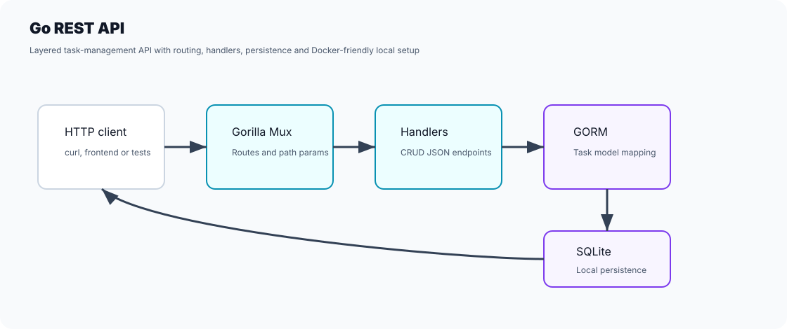

# Go REST API

[English / README principal](README.md) · Português (Brasil)

API REST para gerenciamento de tarefas, desenvolvida com Go, Gorilla Mux, GORM e SQLite.



## O que o projeto demonstra

- Endpoints RESTful para operações CRUD.
- Estrutura em camadas, com rotas, handlers, modelos e configuração do banco de dados.
- Persistência em SQLite por meio do GORM.
- Desenvolvimento local com suporte a Docker.

## Estrutura do projeto

```text
go-rest-api/
  db/
  handlers/
  models/
  routes/
  dockerfile
  docker-compose.yml
  go.mod
  main.go
```

## Executar localmente

```bash
go mod tidy
go run .
```

A API fica disponível em:

```text
http://localhost:8080
```

## Executar com Docker

```bash
docker compose up --build
```

## Endpoints

| Método | Rota | Descrição |
| --- | --- | --- |
| `GET` | `/tasks` | Listar tarefas |
| `GET` | `/tasks/{id}` | Consultar uma tarefa |
| `POST` | `/tasks` | Criar uma tarefa |
| `PUT` | `/tasks/{id}` | Atualizar uma tarefa |
| `DELETE` | `/tasks/{id}` | Excluir uma tarefa |

## Exemplos de requisições

Criar:

```bash
curl -X POST http://localhost:8080/tasks \
  -H "Content-Type: application/json" \
  -d "{\"title\":\"Write README\",\"description\":\"Document the API\",\"done\":false}"
```

Listar:

```bash
curl http://localhost:8080/tasks
```

Atualizar:

```bash
curl -X PUT http://localhost:8080/tasks/1 \
  -H "Content-Type: application/json" \
  -d "{\"title\":\"Write README\",\"description\":\"Add examples\",\"done\":true}"
```

Excluir:

```bash
curl -X DELETE http://localhost:8080/tasks/1
```

## Próximas melhorias

- Adicionar testes unitários para os handlers.
- Adicionar validação de requisições.
- Adicionar paginação e filtros.
- Ampliar as verificações atuais de build e testes no GitHub Actions com testes de integração.
